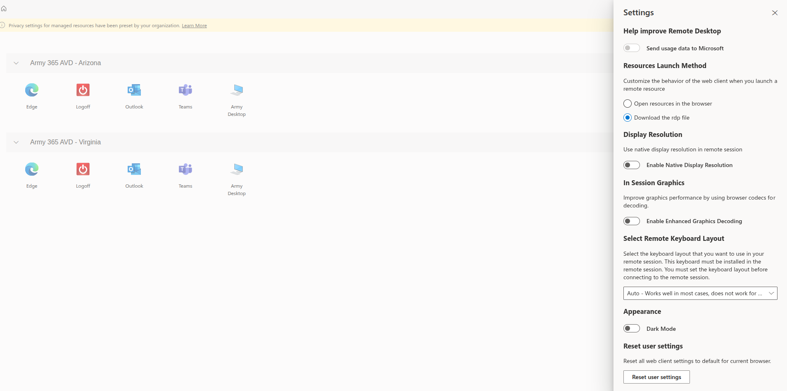
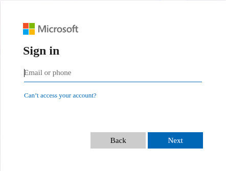
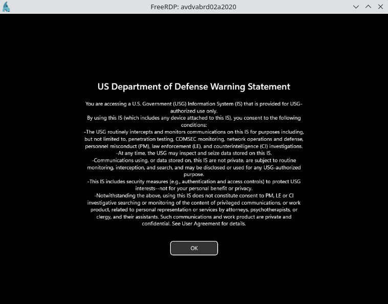

# AVD Python Package

A Python utility for establishing connections to Azure Virtual Desktop (AVD) environments on Linux.

## Overview

This package provides a wrapper for `xfreerdp` to seamlessly handle authentication, smart card routing, and session management when connecting to AVD, specifically optimized for Department of Defense (DoD) and Army environments.

## Prerequisites

This section outlines the prerequisites. The `avd_setup.sh` script will install the following dependencies if they are not already present on your system:

* **FreeRDP:** Properly installed `freerdp3-x11`. (use: `xfreerdp3 /version` to check if you have or not)

* **Flatpak:** Ensure Flatpak is installed for managing certain dependencies.

* **Playwright:** Ensure Playwright is installed for browser automation tasks.

You must also have the following:

* **CAC** and proper drivers installed.

* **Connection File:** A valid AVD `.rdpw` configuration file.

How to retrieve the AVD connection file:

1. Log in to the [AVD portal](https://rdweb.wvd.azure.us/arm/webclient/index.html) portal using your official Army account.
2. Navigate to the "Settings" section and locate the option `Download the rdp file`.
   <br>
3. Select your assigned virtual desktop and it will automatically download the `.rdpw` configuration file to your local machine.

## Installation

**Quick Install (Recommended):**

Install the package directly using the provided wheel file:

```bash
curl -O https://raw.githubusercontent.com/davissondeoliveira/avd/main/avd_setup.sh && chmod +x avd_setup.sh && ./avd_setup.sh
```

## Usage

Start an AVD connection using the `start` command.

```bash
avd start -u <username> -l <path_to_rdp_file>
```

### Options

* `-u, --username`: Your AVD connection username (required). This should be your official `Army.mil` email address.

* `-l, --location`: Absolute or relative path to the AVD connection file you downloaded (default: `Army Desktop.rdpw`).

### Example

```bash
avd start -u john.doe@army.mil -l "/home/user/Downloads/Army Desktop.rdpw"
```

## Authentication Flow

Once the command is executed, the tool will guide you through the standard DoD authentication sequence. Here is what to expect:

1. **Microsoft Sign-in:** You will first be prompted by Microsoft to enter your email.
   <br>

2. **Certificate Selection:** A dialog will appear asking you to select a certificate to authenticate yourself; choose your active DOD ID certificate.

3. **Security Device Unlock:** You must enter your Smart Card PIN to unlock the security device.

4. **Connection Consent:** Microsoft will ask you to confirm and allow the remote desktop connection to the specific AVD host.

5. **DoD Warning Statement:** Finally, the FreeRDP window will launch, presenting the standard US Department of Defense Warning Statement, which you must acknowledge by clicking "OK" to access your desktop.
   <br>

## Support

For technical questions, bug reports, or feature requests, please contact the repository maintainer or open an issue in the project tracker.
